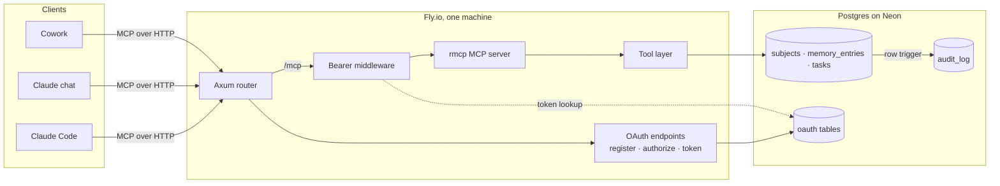

# Pando Design

## 1. Purpose

Pando is a shared memory and task backend for AI assistants. Claude Code, Claude
chat, and Cowork read and write the same subjects, memory, and tasks, so context
set in one surface is already there in the others, and moving to a different AI
later costs a reconnect, not a rebuild.

Non-goals:
- Not a multi-user product: one user, a few trusted clients.
- Not built for scale: correctness over throughput.
- Not a replacement for repo docs or code comments: Pando holds cross-cutting
  personal and project context, not code.

## 2. Architecture

A tool call:
1. The client calls `/mcp` with a bearer token. The middleware hashes it, looks
   it up in `oauth_tokens`, and attaches the client id to the request. No valid
   token gets a `401` pointing at OAuth discovery (§6).
2. rmcp dispatches the call to a tool. Read tools query directly.
3. Mutating tools validate, then open a transaction that sets `pando.actor` (the
   caller's identity) and `pando.client_id`, write, and commit.
4. The audit trigger records each changed row inside that same transaction (§4).

Deployment:
- One Fly machine, always on. MCP sessions and rate-limit counters live in
  memory, so a deploy drops sessions (clients reconnect; tokens are in
  Postgres) and resets the counters. A second machine would split both.
- Postgres on Neon's free plan, which suspends an idle compute. `/health` never
  touches the database, so Fly's probes don't keep it awake; `/ready` does the
  database check.
- CI runs fmt, clippy (warnings as errors), and tests on every PR and push to
  `main`; pushes to `main` deploy.
- Migrations are sqlx files, each with a down file, applied by hand.

## 3. Data model

| Table | Holds | Key |
|---|---|---|
| `subjects` | Anchors: projects, ongoing focuses, relationships | `slug` |
| `memory_entries` | Durable context, optionally scoped to a subject | `id`; unique per `(scope, key)` globally and per subject |
| `tasks` | One-off action items | `id` |
| `audit_log` | Change history for the three tables above (§4) | `id` |
| `oauth_clients`, `oauth_auth_codes`, `oauth_tokens` | OAuth state (§6) | |

- **Subjects.** `category` is `project`, `focus`, or `relationship`, fixed at
  creation. A CHECK ties `status` to it: a project is active, paused, or
  finished; a focus is active or paused; a relationship has none.
- **Memory.** `scope` is `profile`, `topic`, or `preference`. A row with a
  `subject_id` overrides the global row with the same scope and key within that
  subject; `memory_read` falls back from override to global.
- **Tasks.** `status` is `open`, `in_progress`, or `done`; `priority` is `low`,
  `medium` (default), or `high`. `source` is who created a task and `updated_by`
  who last touched it. Subjects and memory carry only `updated_by`: for a living
  fact, who last confirmed it matters more than who first wrote it.
- **Deletes.** `memory_entries.subject_id` is `ON DELETE RESTRICT`, so the only
  path that removes a subject's memory is `subject_delete`, on purpose.
  `tasks.linked_subject` is `ON DELETE SET NULL`: tasks outlive their subject.
- Recurring work is deliberately not a task: a recurring definition with a
  completion history is a different shape from a one-off item.

## 4. Audit trail

One `AFTER INSERT OR UPDATE OR DELETE ... FOR EACH ROW` trigger on `subjects`,
`memory_entries`, and `tasks` writes `audit_log`. Application code never writes
it and no tool modifies it, so every committed write is recorded whatever the
path: MCP, the Neon console, or a script.

- `actor` comes from `pando.actor`. If it isn't set, the trigger raises and the
  write rolls back: unattributed writes are refused, not recorded as anonymous.
  Direct SQL runs `SET pando.actor = '<who>'` first.
- `client_id` comes from `pando.client_id`, the OAuth client that authorized the
  call; `NULL` means the write didn't come through MCP. `actor` is what the
  caller claims; `client_id` is what authentication proves.
- `entity` is `subject`, `memory`, or `task`. `entity_key` is the stable natural
  key: the slug; `scope/key` or `scope/key@subject_id`; the task id.
- `action` is `insert`, `update`, or `delete`. Completing a task is an update.
- `before` is the full prior row as `jsonb` on update and delete, `NULL` on
  insert. It's how an unwatched overwrite or delete is recovered. No `after` is
  stored: the live row, or the next change's `before`, already has it.
- Retention is 30 days, pruned by the trigger on each write, so reads stay pure.
- Deleting a row keeps its history until it ages out. An urgent purge is by hand:
  `DELETE FROM audit_log WHERE entity = $1 AND entity_key = $2`.
- `TRUNCATE` fires no row triggers, so a bulk wipe isn't recorded.
- Code that sets the actor must ship before any trigger change that depends on
  it; the reverse order refuses every write.

## 5. MCP tool contract

Shared rules:
- **Identity.** Every mutation takes a caller identity: `updated_by`, or
  `source` on `task_create`. Each client's config names its string
  (`claude-code`, `claude-chat`, `claude-cowork`). It's free text with no
  allowlist, so a new agent can write without a schema change.
- **No upserts.** Creating something that exists is an error; updating or
  deleting something missing is an error. Silent success would hide a wrong key
  or stale state.
- **No no-ops.** An update must change at least one field.
- **`""` clears.** Nullable fields (`subject.summary`, `task.due_date`) are
  cleared with an empty string; omitting a param leaves it alone. LLM callers
  can't reliably tell an omitted key from `null`.
- **Slugs and keys** match `^[a-z0-9]+(-[a-z0-9]+)*$` and are permanent, so
  casing and spacing drift can't create duplicate entries for one concept.
- **Done is terminal.** Only `task_complete` sets it, enforced in the update
  itself, and nothing reopens it. Text, priority, and due date stay editable.
- Lists are ordered `updated_at desc`. Filters are strict equality and combine.
- A rejected call writes nothing.

**Subjects**

| Tool | Params | Notes |
|---|---|---|
| `subject_create` | `slug, title, category, summary?, updated_by` | Status is set server-side: `active`, or none for a relationship |
| `subject_list` | `slug?, category?, status?` | `slug` doubles as the point lookup |
| `subject_update` | `slug, title?, status?, summary?, updated_by` | Status is validated against the subject's category |
| `subject_delete` | `slug, updated_by` | Deletes the subject's memory in the same transaction; linked tasks survive unlinked |

**Memory**

| Tool | Params | Notes |
|---|---|---|
| `memory_create` | `scope, key, content, description, subject_id?, updated_by` | Content and description required; subject must exist |
| `memory_read` | `scope, key, subject_id?` | Override, else global default, else `null` |
| `memory_update` | `scope, key, subject_id?, content?, description?, updated_by` | Targets the exact row (`IS NOT DISTINCT FROM`), no fallback |
| `memory_delete` | `scope, key, subject_id?, updated_by` | Exact row, no fallback |
| `memory_search` | `query, scope?, subject_id?` | `ILIKE` over key, description, and content; subject filter is strict |
| `memory_list` | `scope?, subject_id?` | Browse; subject filter is strict |

**Tasks**

| Tool | Params | Notes |
|---|---|---|
| `task_create` | `text, source, priority?, due_date?, linked_subject?` | Starts `open`; `source` also seeds `updated_by` |
| `task_list` | `id?, status?, stale_days?, linked_subject?` | `stale_days`: not updated in N days; combines with `status` |
| `task_update` | `id, updated_by, status?, priority?, due_date?, text?` | Status only `open` or `in_progress`, never on a done task; subject link is fixed |
| `task_complete` | `id, updated_by` | Sets `done` and `completed_at`; errors if already done |
| `task_delete` | `id, updated_by` | For mistakes; finished work uses `task_complete` |

**Audit**

| Tool | Params | Notes |
|---|---|---|
| `audit_list` | `since?, after_id?, entity?, entity_key?, actor?, exclude_actor?, limit?, include_before?` | Newest first; with `after_id`, oldest first after that id |

- `limit` defaults to 50, capped at 200. `before` is returned only with
  `include_before`.
- Each row carries `client_name`, joined from `oauth_clients`. It's the name sent
  at registration, which is unauthenticated, so it's a label like `actor`.
- Ids are assigned when a write starts, not when it commits, so an `after_id`
  reader can occasionally miss an overlapping write.
- There's no restore tool: recovery re-applies a `before` through the normal
  update tools, and that write is audited too.

## 6. Security

- **No credentials or secrets are ever stored in Pando.** Excluding sensitive
  content is the backstop, not the only layer.
- Chat needs a public endpoint, so full network isolation isn't an option.
- **Self-hosted OAuth 2.1.** Pando is both authorization and resource server;
  with one resource owner, a third-party identity provider solves nothing.
  - Clients self-register at `/register` (RFC 7591). All are public clients
    with no secret, so PKCE (`S256`) is required on every code exchange.
  - The one human gate is a passphrase-protected `/authorize` page: compared in
    constant time, no session cookie, entered on every authorization.
  - Tokens are opaque; only their SHA-256 hashes are stored. Access tokens live
    about an hour; refresh tokens rotate on every use.
  - `/mcp` answers an unauthenticated call with a `401` whose
    `WWW-Authenticate` points at `/.well-known/oauth-protected-resource`, which
    points at `/.well-known/oauth-authorization-server`. A client needs only
    the `/mcp` URL.
- **Rate limiting.** `/register`, `/token`, and the `/authorize` form submit are
  limited per client IP (from `Fly-Client-IP`), and repeated wrong passphrases
  lock the IP out. Limits are checked before the body is parsed and held in
  memory. Thresholds come from environment variables and are recorded neither
  here nor in source: the repo is public.
- **`/ready`** requires the passphrase in `X-Pando-Passphrase`, compared in
  constant time, and shares the lockout. `/health` is open and never touches the
  database.
- **Logging** uses `tracing`. Every request except `/health` runs in a span with
  a server-generated request id (any client-supplied one is dropped; ours is
  echoed back), the method, and the path. Never headers or the query string:
  they carry the bearer token, the passphrase, and OAuth parameters. Tool calls
  run on rmcp's session task, outside that span. Client IPs appear only on
  rate-limit denials. Output is JSON when `LOG_FORMAT=json`, text when `text` or
  unset; any other value stops startup. Pando and `tower_http` log at `info`,
  other crates at `warn`; `RUST_LOG` overrides.
- rmcp's allowed-hosts check (DNS-rebinding protection) stays on; the server
  adds `PUBLIC_BASE_URL`'s host to the loopback defaults.
- Nothing personal or environment-specific is committed: `.env*` (except
  `.env.example`), seed data, and tokens stay out of the repo.
