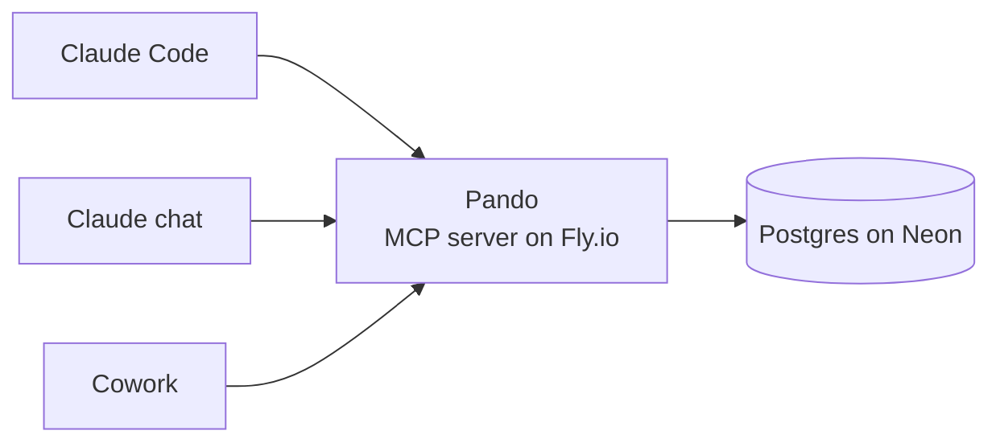

# Pando 🌳

[](https://github.com/MattSarno/pando/actions/workflows/ci.yml)
[](LICENSE)

One memory for all your AIs. A brain, one might say?

> Pando is a grove of quaking aspen in Utah that looks like a forest but is a
> single organism: thousands of trunks, one root system. This project is the
> root system. Claude Code, Claude chat, and Cowork are the trunks.

## Why

Every AI surface keeps its own memory. Decide something in chat, open Claude
Code, and you're explaining it all over again. Pando is one shared store of
subjects, memory, and tasks that every surface reads and writes, so the context
follows you instead of the other way round. And when the next great AI shows up,
it plugs into the same roots.

## How it works



Pando is an MCP server. Every client signs in over OAuth and gets the same tools:

- **Subjects**: the things worth linking to, like projects, ongoing focuses, and people.
- **Memory**: durable context in three flavours: *profile* (facts about me),
  *topic* (what's going on with a subject), and *preference* (how I like things done).
- **Tasks**: real action items, with priorities and due dates.
- **Audit trail**: every change, who made it, and what it overwrote.

No sync, no reconciliation: last write wins, and every call reads current state.

## Design choices worth a look

- **Self-hosted OAuth 2.1.** Dynamic client registration, PKCE, and a
  passphrase-gated authorize page. No API keys to paste around, and no
  third-party auth provider for an audience of one.
- **Writes can't go anonymous.** A Postgres trigger records every change with
  its author and the row it replaced, and refuses any write that doesn't say who
  it is. That's what makes it safe to let agents write on their own.
- **A tool contract built for LLMs.** No silent upserts, `""` clears a field
  (models can't reliably tell "omitted" from `null`), and done tasks stay done.
- **Lets the database nap.** The health check never touches Postgres, so Neon's
  free tier can actually scale to zero.

## Stack

Rust · Axum · rmcp · sqlx · Postgres (Neon) · Fly.io

## Quickstart

You need Rust (stable), a Postgres database, and
[sqlx-cli](https://crates.io/crates/sqlx-cli) (`cargo install sqlx-cli`).

```bash
git clone https://github.com/MattSarno/pando.git
cd pando
cp .env.example .env
```

Fill in `.env`: your `DATABASE_URL`, an `ADMIN_PASSPHRASE` (you'll type it to
authorize clients), the rate-limit values, and
`PUBLIC_BASE_URL="http://localhost:3000"`. Then:

```bash
sqlx migrate run
cargo run
```

Connect Claude Code and sign in with your passphrase:

```bash
claude mcp add --transport http pando http://localhost:3000/mcp
claude mcp login pando
```

To deploy your own, start from `fly.toml` and set the same values as
`fly secrets`.

## Status

v1 is done 🌱 and Pando is in daily use with Claude Code, Claude chat, and Cowork.

## More

- [DESIGN.md](DESIGN.md): architecture, data model, tool contract, and security
- License: [AGPL-3.0-or-later](LICENSE)
